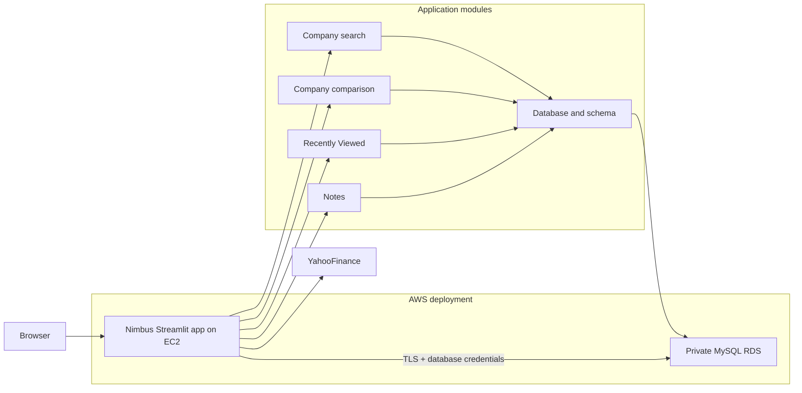

# Nimbus Financial Intelligence

## Overview

Nimbus is a Streamlit dashboard for exploring public company financial data. It retrieves market, statement, news, and analyst information from Yahoo Finance through `yfinance`. Local use still requires an internet connection for those data requests.

The app can run locally or be deployed to AWS with the CloudFormation template in `scripts/nimbus-aws.yaml`.
The demo has no authentication. A selector simulates three fixed demo users, with searches and saved notes scoped to the selected user. This is not access control; do not expose the app publicly unless access is restricted at the network or hosting layer.

## Application Pages

The top navigation contains three pages:

- **Company Search**: Search a ticker to fetch financial statements, recent news, stock price, and analyst ratings together. Use the result selector to navigate among the three views; stock price and analyst ratings is shown first by default, followed by financial statements and recent news. Successful results remain available when switching app pages during the session. A compact favourites row below the search bar shows AAPL, NVDA, and MU with prices cached for five minutes; clicking one fetches all three result views.
- **Company Comparison**: Compare two companies' prices and financial metrics.
- **Recently Viewed**: Review the selected demo user's saved search records, shown five at a time with a Show more control. Select View to open a result dialog with saved notes. New single-company records retain all three fetched datasets; comparison records show matching data cached in the current app session, when available.

Search history and explicitly saved notes are stored in MySQL. Notes remain session drafts until Save is pressed and are linked to a specific search record. The active search notes editor is available from the floating Notes popover, which also provides a user-scoped list of saved notes. Notes opened from Recently Viewed remain read-only in the result dialog. The previous local CSV and SQLite data are not migrated.

## Architecture



The app is organized as a Streamlit entry point (`src/app.py`), feature modules
under `src/features/`, shared Yahoo Finance access in `src/analysis.py`, and
MySQL connection/schema management in `src/database.py`. The AWS template
places EC2 in a public subnet and RDS in private subnets. The database security
group accepts MySQL traffic only from the EC2 app security group. The app
connects over TLS using the RDS CA bundle and a database username/password
provided by CloudFormation. Secrets Manager and database IAM authentication are
not used.

Each browser session selects one of three fixed demo-user IDs. Search history
and saved notes carry that ID and are filtered by it in database queries. This
simulates data separation, but does not authenticate users. Single-company
search results (including fetched DataFrames) are serialized into MySQL JSON.
Comparisons store their tickers and names; comparison metrics and chart
data remain in the active Streamlit session rather than being persisted.
Unsaved notes exist only in the browser session state. Pressing Save writes a
note linked to both the selected user and search record.

## Project Structure

- `src/app.py`: Streamlit entry point, shared page styling, and navigation.
- `src/database.py`: MySQL connection configuration, schema initialization, and demo-user seeding.
- `src/analysis.py`: Shared Yahoo Finance data-access functions.
- `src/features/company_search.py`: Company Search page and result rendering.
- `src/features/favourites.py`: Fixed favourite-company cards and cached price lookup.
- `src/features/company_comparison.py`: Company Comparison page, metrics, and Plotly chart.
- `src/features/company_overview.py`: Expandable company profile details.
- `src/features/loading_screen.py`: Session-level splash animation.
- `src/features/history.py`: User-scoped MySQL persistence and normalization for search history and results.
- `src/features/notes.py`: Session drafts and saved, search-linked MySQL notes.
- `src/features/recent_history.py`: Recently Viewed page and five-row expansion.
- `assets/`: Nimbus logos and optional company logos.
- `scripts/nimbus-aws.yaml`: AWS CloudFormation deployment template.
- `filings.ipynb`, `news.ipynb`, `stock_price_ratings.ipynb`: Exploratory notebooks.
- `requirements.txt`: Python dependencies.
- `scripts/lesson5-nimbus.yaml`: Legacy Nimbus template that predates required RDS configuration; not for the current app.
- `scripts/lesson5.yaml`: Separate course web-server lab template.

See [src/features/README.md](src/features/README.md) for feature-module ownership.

## Requirements and Local Setup

The current development environment uses Python 3.12.16 and Streamlit 1.66.1.
Use Python 3.11 or newer; the AWS template installs Python 3.11 on EC2.
Dependencies are listed in `requirements.txt`, including Streamlit, pandas,
yfinance, and MySQL Connector/Python.

- Python 3.11 or newer
- Streamlit
- pandas
- plotly
- yfinance
- mysql-connector-python
- git
- AWS account access for CloudFormation deployment (optional for local use)

From the project root:

```powershell
py -3.12 -m venv nimbus
.\nimbus\Scripts\python.exe -m pip install --upgrade pip
.\nimbus\Scripts\python.exe -m pip install -r requirements.txt
.\nimbus\Scripts\python.exe -m streamlit run src/app.py
```

### macOS or Linux

```bash
python3.12 -m venv .venv
source .venv/bin/activate
python -m pip install --upgrade pip
python -m pip install -r requirements.txt
python -m streamlit run src/app.py
```

Streamlit prints the local URL, usually `http://localhost:8501`. The environment folders and `.cache/` are ignored by Git.

The app requires a reachable MySQL database to start; it does not fall
back to CSV, SQLite, or an offline mode. For local development, set
`NIMBUS_DB_HOST`, `NIMBUS_DB_NAME`, `NIMBUS_DB_USER`, and
`NIMBUS_DB_PASSWORD`; optionally set `NIMBUS_DB_PORT` and `NIMBUS_DB_SSL_CA`.
When an RDS CA bundle path is supplied, the connector verifies the server
certificate and hostname.
The app also requires internet access to retrieve company data from Yahoo
Finance.

The app creates missing database tables and indexes at startup. This is
initialization, not a versioned migration system; use a fresh database for the
documented disposable demo deployment, or migrate an existing database before
upgrading the schema.

## AWS Deployment

Use `scripts/nimbus-aws.yaml` to deploy the current RDS-backed app in
`us-east-1`. The template provisions EC2 in a public subnet and MySQL RDS
in private subnets, with no NAT gateway: the public EC2 instance uses the
internet gateway for Yahoo Finance and package downloads, while RDS needs no
outbound internet access. The subnet group spans two Availability Zones, but
the database instance itself is single-AZ (`db.t3.micro`) to limit demo cost.
It uses 20 GB of gp3 storage, with encryption, automated backups, and deletion
protection disabled to match the disposable lab setup. CloudFormation selects
the latest Amazon Linux 2023 x86_64 AMI using its public SSM parameter and
installs Python 3.11.

When creating the stack, provide an existing EC2 key pair and an
`AllowedClientCidr` for SSH and Streamlit access. Prefer your current public IP
with `/32`; the template intentionally does not allow every source IP. The
database username defaults to `main` and its password defaults to `password`
for the demo; override the password with a different alphanumeric
value when deploying. The CloudFormation password parameter uses `NoEcho`, but
the credential is also passed to EC2 through instance user data and stored in
a root-only environment file so the app can connect. `NoEcho` does not protect
user data from principals authorized to inspect the EC2 instance or stack.
This static demo credential setup is not appropriate for production.
`GitHubRepoUrl` defaults to this repository and can be changed when deploying
a fork. The `StreamlitUrl` output is the app address; the database endpoint
and port outputs are private VPC connection details.

EC2 setup runs through UserData after the instance launches, so the stack may
finish before the app is ready. Allow a few minutes after creation. Nimbus runs
as a systemd service and is restarted after instance reboots; inspect
`/var/log/cloud-init-output.log` and `journalctl -u nimbus` on the instance if
startup fails. The template is for a disposable demo: it disables RDS backups
and deletes the database with the stack. RDS
storage and EC2 use incur AWS charges while deployed. The app has no real
authentication, so a CIDR allowlist is a network restriction, not a substitute
for authentication. Live deployment has not been verified from this
development environment.

`scripts/lesson5-nimbus.yaml` is a legacy pre-RDS template and does not provide
the database configuration required by the current app. Do not use it to
deploy the current Nimbus application. `scripts/lesson5.yaml` is a separate
course web-server lab template.

## Credits

Team Members: Wei Zihao, Paavas Bansal, Nicolyne Tiana Lie

Course: DS600 Cloud Computing for Economics, SMU MDSE
