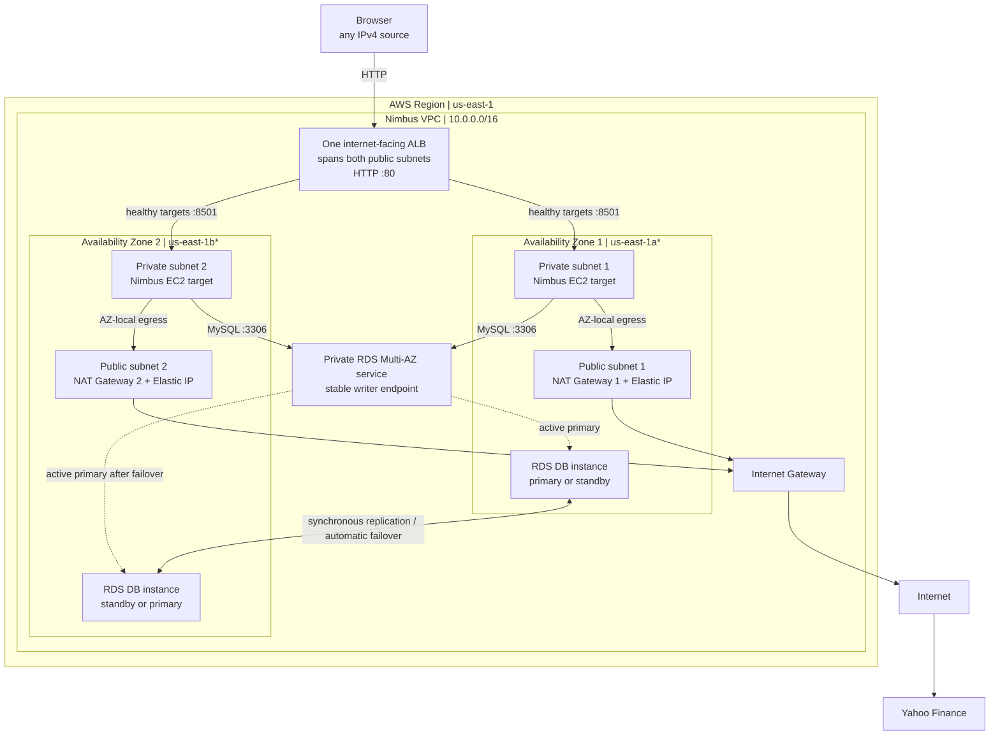

# Nimbus Financial Intelligence

## Overview

Nimbus is a Streamlit dashboard for exploring public company financial data. It retrieves market, statement, news, and analyst information from Yahoo Finance through `yfinance`. Local use still requires an internet connection for those data requests.

The app can run locally or be deployed to AWS with the CloudFormation template in `scripts/nimbus-aws.yaml`.
The demo has no authentication. A selector simulates three fixed demo users, with searches and saved notes scoped to the selected user. This is not access control; do not expose the app publicly unless access is restricted at the network or hosting layer.

## Application Pages

The top navigation contains three pages:

- **Company Search**: Search a ticker to fetch financial statements, recent news, stock price, and analyst ratings together. Use the result selector to navigate among the three views; stock price and analyst ratings is shown first by default, followed by financial statements and recent news. Successful results remain available when switching app pages during the session. A compact favourites row below the search bar shows AAPL, NVDA, and MU with prices cached for five minutes; clicking one fetches all three result views.
- **Company Comparison**: Compare two companies' price histories and financial metrics. Annual revenue and net income, market capitalization, and historical closing prices are normalized to USD using the latest available dated Yahoo Finance FX rates. The page also compares annual revenue/net-income growth and financial ratios. Select the price-history range before comparing; the resulting comparison snapshot, including statements, FX rates, and the selected daily prices, is stored with its MySQL history record.
- **Recently Viewed**: Review the selected demo user's saved search records, shown five at a time with a Show more control. Filter by exact ticker (either ticker for comparisons), inclusive date range, and analysis type. Select View to open a result dialog with saved notes. New single-company records retain all three fetched datasets, and comparison records render their saved snapshots without refetching Yahoo Finance data.

Search history and explicitly saved notes are stored in MySQL. Notes remain session drafts until Save is pressed and are linked to a specific search record. The active search notes editor is available from the floating Notes popover, which also provides a user-scoped list of saved notes. Notes opened from Recently Viewed remain read-only in the result dialog. The previous local CSV and SQLite data are not migrated.

## Architecture



`*` The diagram labels the two zones as `us-east-1a` and `us-east-1b` to
match the deployment described here. AWS Availability Zone letter-to-zone
mapping can differ by account; the template selects the first two available
zones in `us-east-1`, and the account's console shows their actual names.

The app is organized as a Streamlit entry point (`src/app.py`), feature modules
under `src/features/`, shared Yahoo Finance access in `src/analysis.py`, and
MySQL connection/schema management in `src/database.py`. The AWS template
places an internet-facing Application Load Balancer (ALB) in two public
subnets. The ALB accepts HTTP from any IPv4 address (`0.0.0.0/0`) and forwards
traffic to healthy Nimbus instances on port 8501. An EC2 Auto Scaling group runs the app
across two private subnets, with no public IP and app traffic accepted only
from the ALB security group. The Auto Scaling group has minimum and desired
capacity two, maximum six, and 60% average CPU target tracking; it can place
instances in both AZs. Each private subnet has its own route table and
AZ-local NAT Gateway, so a single NAT/AZ failure does not remove outbound
access from the other AZ. The private MySQL database uses RDS Multi-AZ with a
managed standby in another AZ and a stable database endpoint for failover.
ALB target stickiness helps keep a Streamlit browser session on one instance,
but does not preserve in-memory session state if that instance is replaced.
Secrets Manager, database IAM authentication, instance SSH ingress, and HTTPS
are not configured.

Each browser session selects one of three fixed demo-user IDs. Search history
and saved notes carry that ID and are filtered by it in database queries. This
simulates data separation, but does not authenticate users. Single-company
search results (including fetched DataFrames) and versioned comparison
snapshots (company profiles, annual statements, selected-period daily prices,
and historical FX rates) are serialized into MySQL JSON. The Recently Viewed
filters query ticker, date, and analysis type in MySQL while keeping results
scoped to the selected demo user. Comparison amounts use the latest available
FX rate on or before the reported date; unavailable data is shown as N/A with
a warning rather than being estimated. Unsaved notes exist only in the browser
session state. Pressing Save writes a note linked to both the selected user and
search record.

## Project Structure

- `src/app.py`: Streamlit entry point, shared page styling, and navigation.
- `src/database.py`: MySQL connection configuration, schema initialization, and demo-user seeding.
- `src/analysis.py`: Shared Yahoo Finance data-access functions.
- `src/features/company_search.py`: Company Search page and result rendering.
- `src/features/favourites.py`: Fixed favourite-company cards and cached price lookup.
- `src/features/company_comparison.py`: Company Comparison page, metrics, and Plotly chart.
- `src/features/company_overview.py`: Expandable company profile details.
- `src/features/loading_screen.py`: Session-level splash animation.
- `src/features/history.py`: User-scoped MySQL persistence and normalization for search history and results.
- `src/features/notes.py`: Session drafts and saved, search-linked MySQL notes.
- `src/features/recent_history.py`: Recently Viewed page and five-row expansion.
- `assets/`: Nimbus logos and optional company logos.
- `scripts/nimbus-aws.yaml`: AWS CloudFormation deployment template.
- `filings.ipynb`, `news.ipynb`, `stock_price_ratings.ipynb`: Exploratory notebooks.
- `requirements.txt`: Python dependencies.
- `scripts/lesson5-nimbus.yaml`: Legacy Nimbus template that predates required RDS configuration; not for the current app.
- `scripts/lesson5.yaml`: Separate course web-server lab template.

See [src/features/README.md](src/features/README.md) for feature-module ownership.

## Requirements and Local Setup

The current development environment uses Python 3.12.16 and Streamlit 1.66.1.
Use Python 3.11 or newer; the AWS template installs Python 3.11 on EC2.
Dependencies are listed in `requirements.txt`, including Streamlit, pandas,
yfinance, and MySQL Connector/Python.

- Python 3.11 or newer
- Streamlit
- pandas
- plotly
- yfinance
- mysql-connector-python
- git
- AWS account access for CloudFormation deployment (optional for local use)

From the project root:

```powershell
py -3.12 -m venv nimbus
.\nimbus\Scripts\python.exe -m pip install --upgrade pip
.\nimbus\Scripts\python.exe -m pip install -r requirements.txt
.\nimbus\Scripts\python.exe -m streamlit run src/app.py
```

### macOS or Linux

```bash
python3.12 -m venv .venv
source .venv/bin/activate
python -m pip install --upgrade pip
python -m pip install -r requirements.txt
python -m streamlit run src/app.py
```

Streamlit prints the local URL, usually `http://localhost:8501`. The environment folders and `.cache/` are ignored by Git.

The app requires a reachable MySQL database to start; it does not fall
back to CSV, SQLite, or an offline mode. For local development, set
`NIMBUS_DB_HOST`, `NIMBUS_DB_NAME`, `NIMBUS_DB_USER`, and
`NIMBUS_DB_PASSWORD`; optionally set `NIMBUS_DB_PORT` and `NIMBUS_DB_SSL_CA`.
When an RDS CA bundle path is supplied, the connector verifies the server
certificate and hostname.
The app also requires internet access to retrieve company data from Yahoo
Finance.

The app creates missing database tables and indexes at startup. This is
initialization, not a versioned migration system; use a fresh database for the
documented disposable demo deployment, or migrate an existing database before
upgrading the schema.

## AWS Deployment

The CloudFormation template at `scripts/nimbus-aws.yaml` deploys the current
Nimbus app with an ALB, an EC2 Auto Scaling group, and private MySQL RDS in
`us-east-1`. It is a disposable learning/demo configuration, not a production
architecture. The template has not been deployed from this development
environment.

### Architecture and traffic flow

| Component | Configuration and role |
|---|---|
| VPC | `10.0.0.0/16`, with DNS support and hostnames enabled. |
| Public subnets | `10.0.0.0/24` and `10.0.2.0/24`, one in each of the first two AZs selected in `us-east-1`. Both route internet traffic through the Internet Gateway. |
| Private subnets | `10.0.1.0/24` and `10.0.3.0/24`, one in each selected AZ. The Auto Scaling group and Multi-AZ RDS subnet group use both. Each private subnet has its own route table. |
| Application Load Balancer | Internet-facing ALB across both public subnets. Its security group allows HTTP port 80 from any IPv4 address (`0.0.0.0/0`). It forwards requests to healthy target instances on port 8501. |
| App Auto Scaling group | EC2 instances run Nimbus in both private subnets with no public IPv4 addresses. The group uses the latest Amazon Linux 2023 x86_64 AMI, `t2.micro`, and Python 3.11. Desired/minimum capacity is 2, maximum is 6, and target tracking aims for 60% average CPU. |
| NAT Gateways | One NAT Gateway and Elastic IP in each public subnet. Each private subnet routes outbound internet traffic through its same-AZ NAT for bootstrap and Yahoo Finance access. |
| MySQL RDS | Private MySQL `db.t3.micro`, database `nimbus`, 20 GB gp3, in a subnet group spanning both private subnets. RDS Multi-AZ maintains a synchronous standby in another AZ and manages failover. It is not publicly accessible; port 3306 is allowed only from the app security group. |

Client traffic flows over HTTP from any IPv4 address to the ALB, then from
the ALB to healthy Nimbus targets in either AZ. App instances connect to
the RDS writer endpoint over port 3306 and reach external sites through their
AZ-local NAT Gateway. If one AZ fails, the ALB and Auto Scaling group can
continue serving through the other AZ; RDS performs a managed failover to its
standby. Existing Streamlit in-memory sessions may be lost if their instance
fails. Security groups allow app ingress only from the ALB and database ingress
only from the app security group.

This redundant design costs more than the original sandbox setup: two NAT
Gateways incur separate hourly and data-processing charges, and RDS Multi-AZ
incurs standby instance charges. Two app instances also run at the configured
minimum. The ALB, EC2, RDS, storage, and data transfer can all incur charges.
Check AWS Budgets, service quotas, and learner-lab restrictions before
deploying.

### Deploy or update the stack

1. In the AWS Console, switch to **US East (N. Virginia), `us-east-1`**. The
   template selects Availability Zones from this region.
2. Open **CloudFormation** and choose **Create stack** → **With new resources
   (standard)**. For a new stack, upload `scripts/nimbus-aws.yaml`. To update an
   existing Nimbus stack, choose **Update** and provide the revised template.
3. Enter a stack name and set the parameters:
   - There is no client-CIDR parameter. The ALB security group allows HTTP
     traffic from any IPv4 address (`0.0.0.0/0`).
   - **`GitHubRepoUrl`** defaults to this repository; change it if deploying a
     fork that the instances can access.
   - **`LatestAmiId`** defaults to the public SSM parameter for the latest
     Amazon Linux 2023 x86_64 AMI. Normally leave this default.
   - **`DatabaseMasterUsername`** defaults to `main`.
   - **`DatabaseMasterPassword`** defaults to the demo value `password`.
     Override it with an 8–41 character alphanumeric value. The value is
     marked `NoEcho`, but is still passed through EC2 user data and stored in
     a root-only environment file; authorized principals can inspect instance
     user data. Do not treat this as production secrets management.
4. Review the stack options and acknowledge the resource changes. The template
   creates an internet-facing ALB, two NAT Gateways with Elastic IPs, an Auto
   Scaling group, and Multi-AZ RDS. This costs more than single-AZ resources;
   AWS learner environments may restrict Multi-AZ RDS or NAT Gateways.
5. Create/update the stack and wait for `CREATE_COMPLETE` or
   `UPDATE_COMPLETE`. On initial deployment, allow additional time for EC2 user
   data to install packages, clone the repository, and start Nimbus.
6. Open the **`StreamlitUrl`** output. It is the HTTP address of the ALB; the
   `LoadBalancerDns` output gives its DNS name. The database endpoint and port
   outputs are private VPC details. The webpage is reachable from any IPv4
   address.

No EC2 key pair is configured and port 22 is not open: the app instances are
private and have no direct SSH access. Systems Manager access is also not
configured. The app has no real user authentication and the ALB uses HTTP, not
HTTPS. Anyone on the IPv4 internet can reach the Nimbus webpage, and traffic is
not encrypted in transit. Do not use this open configuration for sensitive
data or production workloads; restrict the ALB ingress or add authentication
and HTTPS before such use.

### Scaling, operations, and data lifecycle

The Auto Scaling group starts with two instances and stays between two and six.
CloudWatch group metrics are collected at one-minute intervals; a target
tracking policy adjusts capacity around 60% average CPU utilization. CPU-based
scaling may not correspond to every kind of request load, and capacity changes
take time because user data installs the app on each new instance. The ALB
health-check grace period is 15 minutes to accommodate this bootstrap.

Each instance installs Git and Python 3.11, clones the configured repository,
installs `requirements.txt`, downloads the RDS CA bundle, writes DB connection
settings, and enables Nimbus as a systemd service. If startup fails, inspect
the instance's cloud-init output and `journalctl -u nimbus`; without SSM or SSH,
you will need to add a private administration method before connecting to the
instance to inspect those logs.

RDS is Multi-AZ, but encryption, automated backups, and deletion protection
remain disabled. Multi-AZ improves availability; it is not a backup. The
CloudFormation deletion and replacement policies delete the database. Back up
any data you need before deleting the stack.
Updating the old single-instance template creates the ALB and Auto Scaling
resources and removes the standalone public EC2 instance; app sessions on that
instance will be interrupted, but the existing RDS resource is retained by
this template update. Review the CloudFormation change set before applying an
update.

`scripts/lesson5-nimbus.yaml` is a legacy pre-RDS template and does not provide
the database configuration required by the current app. Do not use it to
deploy the current Nimbus application. `scripts/lesson5.yaml` is a separate
course web-server lab template.

## Credits

Team Members: Wei Zihao, Paavas Bansal, Nicolyne Tiana Lie

Course: DS600 Cloud Computing for Economics, SMU MDSE
